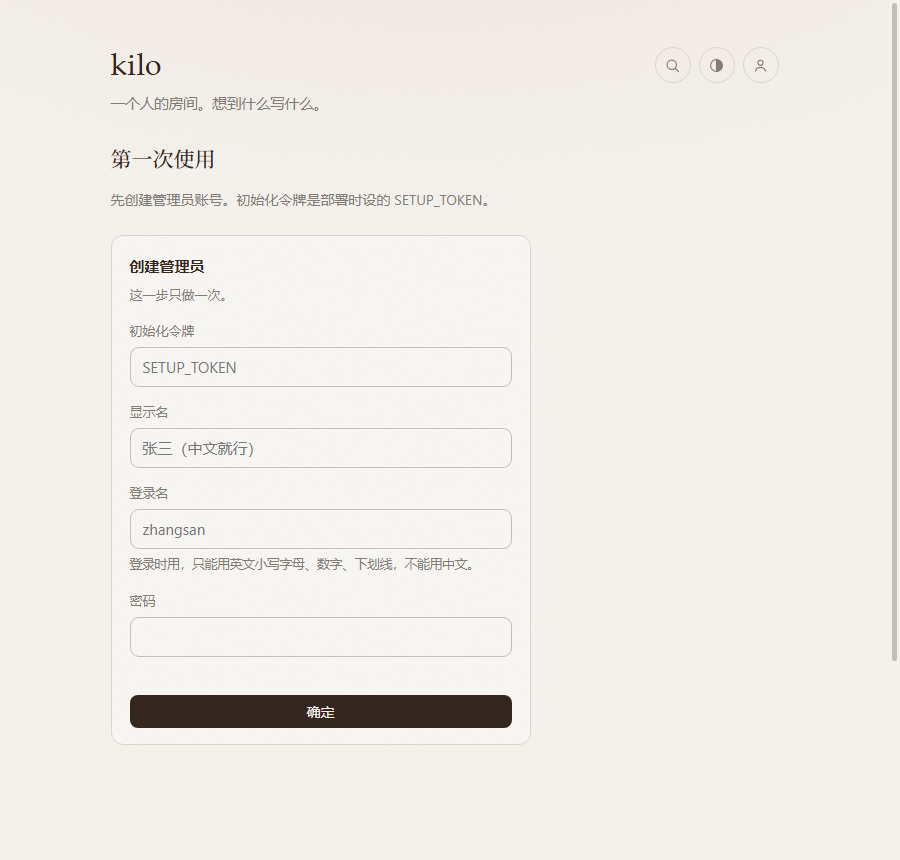

# 部署手册

从一台空白电脑，到八个人在里面说话。不用买服务器、不用绑信用卡。

README 讲「这是什么」，这里只讲**怎么做，以及怎么确认做对了**。
每一步都给了验收标准——做完看不到它说的输出，就先别往下走。

---

## 0. 开工前

| 需要 | 怎么确认 | 没有怎么办 |
| --- | --- | --- |
| Cloudflare 账号 | 能登进 [dash.cloudflare.com](https://dash.cloudflare.com) | 注册一个，邮箱即可 |
| Node.js 20+ | `node -v` 看到 v20 / v22 / v24 | [nodejs.org](https://nodejs.org) 下 LTS |
| 项目文件 | 有个 `kilo` 文件夹 | `git clone` 或解压 zip |

**终端在哪**：macOS 搜「终端」，Windows 搜「PowerShell」。
下文命令都是跨平台的，Windows 差异会单独标出来。

---

## 1. 装部署工具（只装一次）

```bash
npm i -g wrangler
wrangler --version
```

**验收**：打印 `4.x.x`。

- 报 `permission denied` → macOS / Linux 加 `sudo`
- 报 `command not found` → 别修 PATH，后面所有命令前加 `npx ` 就行

---

## 2. 登录

```bash
wrangler login
```

浏览器弹出，选账号，点 **Allow**。

**验收**：`Successfully logged in`。

---

## 3. 进项目目录

```bash
cd 你的路径/kilo
cp wrangler.example.toml wrangler.toml
ls
```

**验收**：能看到 `wrangler.toml`、`schema.sql`、`src`、`public`。

> Windows PowerShell 用 `Copy-Item wrangler.example.toml wrangler.toml` 和 `dir`。
> 仓库里的 `wrangler.toml` 是本地文件，已被 `.gitignore` 排除；模板是 `wrangler.example.toml`。
> 后面每条命令都必须在这个目录下执行，否则报 `Couldn't find a wrangler.toml`。

---

## 4. 建数据库

```bash
wrangler d1 create kilo
```

输出里有一段配置，重点是这两行：

```
database_name = "kilo"
database_id   = "a1b2c3d4-0000-1111-2222-333344445555"
```

打开 `wrangler.toml`，把 `[[d1_databases]]` 下面这两行换成你的值。

**验收**：`wrangler.toml` 里的 `database_id` 不再是一串示例。

> 新版 wrangler 可能反问 *"Would you like Wrangler to add it on your behalf?"*，输 `y` 回车。
> `binding = "DB"` 那行别动。

---

## 5. 建表

```bash
wrangler d1 execute kilo --remote --file=./schema.sql
```

**验收**：输出里有 `"success": true`。

再确认一次：

```bash
wrangler d1 execute kilo --remote --command "SELECT name FROM sqlite_master WHERE type='table'"
```

应该看到 `users`、`notes`、`comments`、`images`、`invites`、`settings` 六张表。

> **`--remote` 绝对不能省。** 省了表会建在本地模拟库里，线上还是空的，
> 打开网站会一直提示「第一次使用」。

---

## 6. 配图片存储（KV / B2 / R2 三选一）

图片存储和文字功能是分开的：一种都不配，站点照常跑——发文字、评论、换头像都正常，
只是发帖框的图片按钮会消失。推荐先配 **Workers KV**：最快、免费额度内、不用外部账号。

### 方案 A：Workers KV（推荐，默认）

```bash
wrangler kv namespace create kilo-images
```

输出里有一行 `id = "..."`，打开 `wrangler.toml`，填到：

```toml
[[kv_namespaces]]
binding = "IMAGE_KV"
id = "你的 id"
```

**验收**：`wrangler deploy` 后打开 `https://你的站点/api/site`，看到
`"images_ready": true`、`"image_storage": "kv"`。

> KV 免费额度：1 GB 存储、10 万读/天、1 千写/天。按压缩后 200KB 一张，约 5000 张。
> 同一机房写入立即可见，其他机房最多晚 60 秒。

### 方案 B：Backblaze B2（10GB，方便 rclone 备份）

1. B2 控制台建一个**私有**桶，记下桶名、S3 endpoint、region
2. 建一个 Application Key，勾选读 / 写 / 删权限
3. 改 `wrangler.toml`：

```toml
[vars]
IMAGE_STORAGE = "b2"
B2_BUCKET = "你的桶名"
B2_ENDPOINT = "https://s3.us-east-005.backblazeb2.com"
B2_REGION = "us-east-005"
```

4. 设两个 secret：

```bash
wrangler secret put B2_KEY_ID
wrangler secret put B2_APP_KEY
```

**验收**：`/api/site` 里 `"image_storage": "b2"`；上传一张图，返回里有 `"store": "b2"`。

> B2 桶如果开了版本控制，本项目删除时会清掉该 key 的所有历史版本，不会只留删除标记。
> B2 冷读比 KV 多一次回源，实测多约 0.4 秒，但只发生在每个机房第一次读某张图时。

### 方案 C：Cloudflare R2（可选）

先 **Dashboard → Storage & databases → R2 → Overview → Enable**，选 Free，然后：

```bash
wrangler r2 bucket create kilo-images
```

取消 `wrangler.toml` 里 `[[r2_buckets]]` 三行的注释，绑定名保持 `IMAGES`，再部署一次。

**验收**：`/api/site` 里 `"storage_available": {"r2": true, ...}`。

> 配好任意一种之后，后台 → **站点 → 图片 → 存储方式** 还能随时切；
> 写入只进当前存储，读取会自动回退到其他已配置存储。


---

## 7. 设两个密钥

```bash
wrangler secret put SESSION_SECRET
```

提示 `Enter a secret value:` 时输一串长随机字符。**屏幕上不显示字符是正常的，不是卡住了。**

不想自己想，生成一串：

```bash
openssl rand -hex 32
```

> Windows 没有 `openssl`，用这条：
> `node -e "console.log(require('crypto').randomBytes(32).toString('hex'))"`

再设一个初始化口令：

```bash
wrangler secret put SETUP_TOKEN
```

自己定一串只有你知道的口令。**这个只在第一次建管理员时用一次**，建完就没用了。

> 用 B2 的话，再加两个 secret：`wrangler secret put B2_KEY_ID`、`wrangler secret put B2_APP_KEY`。

**验收**：

```bash
wrangler secret list
```

至少看到 `SESSION_SECRET` 和 `SETUP_TOKEN`；用 B2 的话还有 `B2_KEY_ID`、`B2_APP_KEY`。

---

## 8. 部署

```bash
wrangler deploy
```

首次会问 `Would you like to register a workers.dev subdomain?`，起个全球唯一的名字。

**验收**：终端最后打印

```
https://kilo.你的子域.workers.dev
  <你的域名> (custom domain)      ← 绑了域名才会有这行
```

打开它。

---

## 9. 建管理员

第一次打开站点，页面会引导你「第一次使用」：

1. 初始化令牌 → 填第 7 步的 `SETUP_TOKEN`
2. 显示名 → 别人看到的名字，**中文随便写**
3. 登录名 → **只能用英文小写字母、数字、下划线**，比如 `zhangsan`。不能填中文
4. 密码 → 至少 6 位

> 显示名是纯英文时，登录名会自动跟着填；显示名写中文就自己起一个英文登录名。
> 登录名只是登录用，页面上显示的一直是「显示名」。



**验收**：提交后直接进到「管理后台」，右上角头像变成你的。

> 这一步只能做一次。做完再访问 `/api/setup` 会返回「已经初始化过了」。

---

## 10. 加人

后台 → **用户** → **添加用户**：

1. 填登录名和显示名，点创建
2. 弹出一个 **6 位邀请码**，点「复制链接」把整条链接发给对方
3. 对方打开链接，输邀请码 + 自己设密码，就激活了

**验收**：用户列表里那个人从「待激活」变成「正常」，且 `上次登录` 有了时间。

- 邀请码 **72 小时**有效，过期就让管理员点「重置密码」重新生成
- 默认上限 8 个（含管理员），**后台 → 用户 → 人数上限**随时能改（1–50）；满了「添加用户」按钮会变灰
- 管理员**看不到**任何人的密码，只能清空重设

> 想重置某人：用户列表 → 「重置密码」→ 对方旧会话立刻失效，拿到新邀请码重新激活。

---

## 11. 绑自己的域名（建议）

`*.workers.dev` 这类共享域名在部分网络下访问不稳定。想长期稳定打开，绑自己的域名。

前提：域名（或上级 zone）已托管在同一个 Cloudflare 账号下。
把 `wrangler.toml` 里这三行取消注释，域名换成你自己的：

```toml
[[routes]]
pattern = "kilo.你的域名.com"
custom_domain = true
```

再 `wrangler deploy` 一次。

**验收**：部署输出里出现 `kilo.你的域名.com (custom domain)`，浏览器能打开。证书自动签发，1–2 分钟生效。

> 绑好之后这三行就要一直留着。部署时路由按这份配置同步，注释掉再部署等于解绑。

---

## 12. 日常

| 想做的事 | 怎么做 |
| --- | --- |
| 写一条 | 登录后点右下角悬浮按钮，或按 `n`；`Ctrl/⌘ + Enter` 发布 |
| 加图 | 发布框左边的图片按钮，或直接把图拖进去 / 粘贴进去 |
| 看大图 | 点图，左右键切换，`Esc` 关掉 |
| 评论 | 点条目右下角「回复」，在弹窗里写；详情页看全部评论 |
| 改 / 置顶 / 删除 | 悬停条目右上角的铅笔 / 图钉 / 垃圾桶 |
| 按标签看 | 点正文里的 `#标签` |
| 搜索 | 右上角放大镜，回车 |
| 换主题 | 右上角图标，点一下循环：跟随系统 → 浅色 → 深色 |
| 改自己的资料 | 点右上角头像 → 我的资料 |
| 换头像 | 我的资料 → 换头像（压成 192px 存数据库，不占图片存储） |
| 改站点名和配色 | 后台 → 站点 |
| 开关图片功能 | 后台 → 站点 → 开关 → 图片功能（没配存储时是灰的） |
| 换图片存储 | 后台 → 站点 → 图片 → 存储方式；新图写新存储，旧图仍能读 |
| 改人数上限 | 后台 → 用户 → 人数上限，填 1–50 再保存 |
| 看用量 / 备份 | 后台 → 数据 |
| 手机当 App | 浏览器 → 分享 → 添加到主屏幕 |

---

## 13. 备份与恢复

后台 → **数据**：

- **下载备份 JSON**：用户、条目、评论、配置、图片索引，一个文件全带走
- **恢复**：选那个 JSON，确认后覆盖。**现有数据会全被删掉**，恢复前先导一份

**图片文件不在 JSON 里**，恢复后图片要原存储还在。按你用的存储选一种备份：

```bash
# B2：rclone 可增量同步，最省事
rclone sync b2:your-bucket ./backup-images

# R2：同理
rclone sync r2:kilo-images ./backup-images

# KV：先列出 key，再逐个导出（key 多时比较慢）
wrangler kv key list --namespace-id=你的命名空间ID --remote
wrangler kv key get "i/202610/xxxx.webp" --namespace-id=你的命名空间ID --remote > out.webp
```

建议每月导一次 JSON，丢进网盘或私有仓库。如果图片很多、又想要省事的批量备份，
可以在后台把存储切到 B2，再用 rclone 同步——切换不影响旧图读取。

---

## 14. 报错对照

| 现象 | 原因 | 解决 |
| --- | --- | --- |
| `command not found` | 全局目录不在 PATH | 命令前加 `npx ` |
| `Couldn't find a wrangler.toml` | 不在项目目录 | `cd` 到有 `wrangler.toml` 的那层 |
| `Authentication error` | 没登录 / 过期 | 重跑 `wrangler login` |
| 页面一直「第一次使用」 | 数据库没建表，或建在本地 | 重跑第 5 步，务必带 `--remote` |
| 提交管理员提示「已经初始化过了」 | 之前建过 | 直接去登录页 |
| 图片按钮不见了 | 没配图片存储，或绑定没生效 | 看 `/api/site` 的 `images_ready`；回第 6 步 |
| 上传返回「图片存储还没配置」 | KV/B2/R2 一个都没配好 | 检查绑定和 `B2_*` 变量 / secret |
| 上传返回「图片写入失败」 | B2 凭据、桶名或 endpoint 不对 | 重设 `B2_KEY_ID` / `B2_APP_KEY`，确认 endpoint 是 S3 地址 |
| 删了图还能打开 | 浏览器或中间层缓存 | 先强刷；本项目已带 `no-store` 和缓存清理，正常刷新后应为 404 |
| 上传提示「太频繁」 | 每小时超过 40 张 | 等一会儿，或自己调 `src/images.js` 里的 `HOURLY_LIMIT` |
| 登录点了没反应 | 浏览器拦了 Cookie | 允许本站 Cookie；必须是 https |
| 改了配置没变化 | 没保存 | 后台点「保存设置」，配置存数据库，不用重新部署 |
| 域名打不开 | 证书还在签 | 等 1–2 分钟；Dashboard → Workers → kilo → Settings → Domains |

**看实时日志**（排查 500 最有用）：

```bash
wrangler tail
```

---

## 附 A：本地开发

```bash
cp wrangler.example.toml wrangler.toml   # 本地没有的话先复制
cp .dev.vars.example .dev.vars           # 填本地测试用的密钥
wrangler d1 execute kilo --local --file=./schema.sql
wrangler dev                             # http://127.0.0.1:8787
```

本地 KV 和 R2 由 Miniflare 模拟，**不需要真开通**，图片功能可以正常测。

> **B2 是真实外部服务**：本地 `.dev.vars` 里填了 B2 的 key，`wrangler dev` 就会写进真桶。
> 只想本地随便试，就保持 `IMAGE_STORAGE=kv`（`.dev.vars.example` 的默认值）。

本地数据在 `.wrangler/` 里，删掉就是重来。

> 端口被占用时换一个：`wrangler dev --port 8792`。
> 本地是 http，登录 Cookie 会自动去掉 `Secure` 标记，浏览器能存住。

---

## 附 B：完全不想碰命令行

走 GitHub 自动部署，全程网页点：

1. 把项目推到 GitHub（私有也行）
2. Dashboard → **Workers & Pages** → **Create** → **Workers** → **Connect to Git**，选仓库
3. Build command 留空，Deploy command 填 `npx wrangler deploy`
4. 在 **Storage & databases** 建 D1，再选一种图片存储：KV（建 namespace）、B2（建桶 + key）或 R2，把 ID / 名字填进仓库的 `wrangler.toml`
5. 回到 Worker 的 **Settings → Bindings**，加 `DB`；用 KV 就加 `IMAGE_KV`，用 R2 就加 `IMAGES`
6. **Settings → Variables and Secrets**，加 `SESSION_SECRET`、`SETUP_TOKEN`；用 B2 再加 `B2_KEY_ID`、`B2_APP_KEY` 和三个 `B2_*` 变量
7. 在 D1 的 **Console** 里粘贴 `schema.sql` 的内容执行
8. 重新 push 一次触发部署

> 仓库默认把 `wrangler.toml` 排除了（每套部署的 ID 不同）。走 GitHub 自动部署时，
> 填好模板后执行 `git add -f wrangler.toml` 一起提交，否则构建时找不到配置文件。
> D1 / KV 的 ID 不是密钥，可以公开；不想公开就改用命令行部署。

步骤更多，但全程网页。只是自己用的话，命令行走法快得多。

---

## 时间预算

| 步骤 | 耗时 |
| --- | --- |
| 装 Node + wrangler | 3 分钟（一次性） |
| 建库 + 建表 + 配图片存储 + 密钥 + 部署 | 5 分钟 |
| 建管理员 + 加人 | 2 分钟 |
| 绑域名 | 2 分钟 + 等证书 |
| 之后每次改代码上线 | `wrangler deploy` 一条命令，10 秒 |

---

**本项目全部内容由 AI 生成** —— Agent：WorkBuddy，模型：DeepSeek V4.1 Flash。
