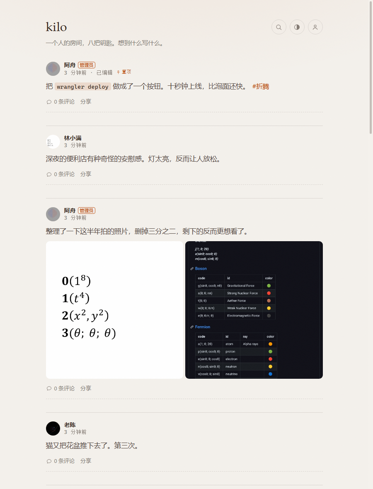
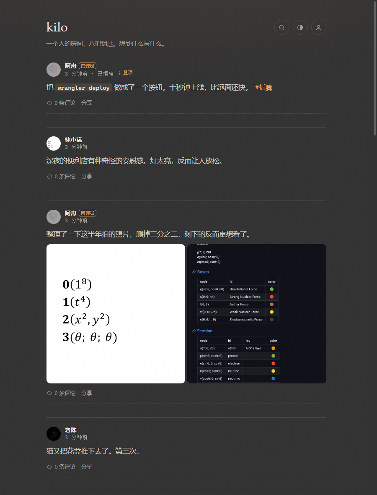

# kilo

**多人微博客 · 跑在 Cloudflare Workers + D1 上，图片存储可切 Workers KV / Backblaze B2 / R2**

一个人写是博客，八个人写是一个小圈子。发文字、发图、互相评论，零服务器、零运维。

<table>
  <tr>
    <td width="50%" valign="top"></td>
    <td width="50%" valign="top"></td>
  </tr>
</table>

左：浅色。右：深色。同一条时间线，日期分组、头像、九宫格图片、评论入口都在。

---

## 特性

- **多用户**：默认 8 个账号（含管理员），后台随时能改（1–50）。管理员建名字，用户自己用邀请码设密码，谁都看不到别人的密码
- **图片**：一条最多 9 张，上传前浏览器先压到最长边 1600px 的 WebP，九宫格排版 + 点击看大图。
  图片存储可在 **Workers KV（默认）/ Backblaze B2 / R2** 之间切换，旧图跨存储自动回退读取。
  管理员可以在后台整个关掉图片功能
- **头像与简介**：头像压成 192×192 直接存数据库，**不依赖 R2**，每人一个主页
- **评论**：每条下面直接评，详情页看全部
- **管理员后台**：改站点名、介绍、页脚，改深浅两套配色，管用户、重置密码、看用量
- **一键备份**：全部数据导出成一个 JSON，选文件即可恢复
- **时间线**：日期分组、置顶、标签、搜索、无限滚动
- 深浅色跟随系统，也能手动切；「添加到主屏幕」像个 App
- 零构建：一个 CSS、三个 JS 模块，没有框架，没有打包步骤

单条正文上限 5000 字，评论 1000 字。

---

## 快速开始

需要 Cloudflare 账号和 Node.js 20 以上。

```bash
git clone https://github.com/panoramainversion/kilo.git
cd kilo
cp wrangler.example.toml wrangler.toml
npm i -g wrangler && wrangler login

# 1. 数据库
wrangler d1 create kilo
# 把输出里的 database_name / database_id 填进 wrangler.toml
wrangler d1 execute kilo --remote --file=./schema.sql

# 2. 图片存储（三选一，推荐 KV）
wrangler kv namespace create kilo-images
# 把输出里的 id 填进 wrangler.toml 的 [[kv_namespaces]]，binding 保持 IMAGE_KV
# 想用 B2 / R2 见下面「图片怎么存」

# 3. 两个密钥
wrangler secret put SESSION_SECRET    # 一串长随机字符
wrangler secret put SETUP_TOKEN      # 首次建管理员用的口令

# 4. 上线
wrangler deploy
```

仓库里只带 `wrangler.example.toml` 模板，真实的 `wrangler.toml` 被 `.gitignore` 排除；
复制之后把 D1 / KV 的 ID 填进去即可。资源 ID 不是密钥，但每套部署都不一样，所以不写死在仓库里。

打开站点，第一次会引导你建管理员：输入 `SETUP_TOKEN`、登录名、显示名、密码，完事。

> 模板里的 `[[routes]]` 默认是注释掉的，先用 workers.dev。
> 想绑域名：取消注释、填上自己的域名，再 `wrangler deploy` 一次，证书自动签发。

---

## 图片怎么存

分两套，互不影响：

| | 存哪 | 依赖 | 上限 |
| --- | --- | --- | --- |
| 帖子图片 | KV / B2 / R2 三选一 | 配好至少一种存储 + 后台开关打开 | 一条 9 张，单张 3MB（可调） |
| 头像 | D1（`users.avatar_data`，data URL） | 什么都不用开 | 192×192，约 15KB |

头像是刻意不走对象存储的：8 个人、每人一张 192px 的图，加起来不到 150KB，塞数据库里最省事。

帖子图片的元数据（谁传的、多大、宽高）在 D1，文件路径是 `i/年月/随机串.webp`。
后台 → **站点 → 图片 → 存储方式** 可以随时切换：

| 驱动 | 需要配置 | 免费额度 | 特点 |
| --- | --- | --- | --- |
| **Workers KV**（默认） | `[[kv_namespaces]]` 绑定 `IMAGE_KV` | 1 GB / 10 万读/天 / 1 千写/天 | 冷读最快；同一机房写入立即可见，其他机房最多晚 60 秒 |
| **Backblaze B2** | `B2_KEY_ID`、`B2_APP_KEY` 两个 secret，`B2_BUCKET` / `B2_ENDPOINT` / `B2_REGION` 三个变量 | 10 GB；免费出站 1 GB/天 | 容量大，`rclone` 备份方便；冷读要多一次回源 |
| **Cloudflare R2** | 后台开通 R2，绑定 `IMAGES` | 10 GB；出站免费 | 需要先在 Dashboard 开通，本项目没默认启用 |

- `auto` 会按 **B2 → KV → R2** 选第一个可用的；后台也可以固定某一个
- 写入只写当前存储，失败时自动尝试下一个；读取先找当前存储，找不到再回退其他存储；删除会清理所有已配置存储
- 上传前浏览器用 canvas 压一遍：最长边 1600px、WebP 质量 0.82，一张手机照片通常从 3MB 变成 200KB
- 服务端只看**文件头**判断类型（JPG/PNG/GIF/WebP），不信客户端声明的 Content-Type
- 每人每小时最多 40 张，超了返回 429
- 读图先走 Workers 边缘缓存；响应带 `X-Robots-Tag: noindex`，不会被搜索引擎当图床收录
- B2 对象不写长缓存头，读的时候带一个随机参数绕过中间缓存；桶开了版本控制时，删除会连历史版本一起清掉

### 大陆访问速度（实测）

2026-10-20，河南联通 → Cloudflare **LAX**，同一张 194KB WebP，每个存储 20 次冷读
（唯一查询串绕过 Workers 缓存，响应头 `x-image-store` 校验实际来源）：

| 存储 | TTFB 中位 | TTFB p90 | 总耗时中位 |
| --- | --- | --- | --- |
| Backblaze B2 | 1.216s | 1.267s | 1.632s |
| Workers KV | **0.800s** | **0.820s** | **1.205s** |

命中 Workers 边缘缓存后的热读两者都由 Cloudflare 返回，差别可以忽略——也就是说
B2 多出来的约 0.4 秒只发生在**每个机房第一次读某张图**时。

结论：默认用 **KV**（冷读最快、不用外部依赖）；如果更看重 10GB 容量和 `rclone` 批量备份，
后台一键切 **B2**，旧图仍然能读。

**KV 的 1GB 够用多久**：按压缩后 200KB 一张，约 5000 张；一年发 500 张能用十年。
真不够了再切 B2 或 R2，不用改代码。

---

## 权限

| 能做 | 游客 | 普通用户 | 管理员 |
| --- | :---: | :---: | :---: |
| 看时间线 / 搜索 / RSS | ✓ | ✓ | ✓ |
| 发帖、发图、评论 | | ✓ | ✓ |
| 改自己的资料、密码、头像 | | ✓ | ✓ |
| 改 / 删自己的帖和评论 | | ✓ | ✓ |
| 改 / 删别人的帖和评论 | | | ✓ |
| 改站点配置、管用户、备份 | | | ✓ |

评论可以在后台整体关掉；置顶也可以关。

---

## API

| 方法 | 路径 | 说明 |
| --- | --- | --- |
| GET | `/api/site` | 站点配置（公开） |
| POST | `/api/setup` | 首次建管理员，要 SETUP_TOKEN |
| POST | `/api/login` | 登录 |
| POST | `/api/logout` | 退出 |
| GET | `/api/me` | 当前用户 |
| POST | `/api/activate` | 邀请码 + 设密码 |
| POST | `/api/me/password` | 改密码 |
| PATCH | `/api/me` | 改名字 / 简介 / 头像 |
| GET | `/api/notes?limit&offset&tag&q&user` | 列表 |
| GET | `/api/notes/:id` | 单条 + 全部评论 |
| POST | `/api/notes` | 发帖 |
| PATCH | `/api/notes/:id` | 改内容 / 置顶 |
| DELETE | `/api/notes/:id` | 删帖（连图和评论一起） |
| POST | `/api/notes/:id/comments` | 评论 |
| DELETE | `/api/comments/:id` | 删评论 |
| POST | `/api/upload?w=&h=` | 上传图片，body 是原始二进制 |
| GET | `/i/:key` | 读图 |
| GET | `/api/admin/users` | 用户列表 |
| POST | `/api/admin/users` | 建号，返回邀请码 |
| POST | `/api/admin/users/:id/reset` | 清空密码 + 新邀请码 |
| DELETE | `/api/admin/users/:id` | 删号（连带内容） |
| GET/PATCH | `/api/admin/settings` | 站点配置 |
| GET | `/api/admin/stats` | 用量 |
| GET | `/api/admin/backup` | 下载备份 JSON |
| POST | `/api/admin/restore` | 恢复，body 要带 `confirm: "RESTORE"` |
| GET | `/feed.xml` | RSS 2.0 |

---

## 项目结构

```
kilo/
├── wrangler.example.toml # 配置模板，复制成 wrangler.toml 后填自己的 ID
├── schema.sql          # 六张表：users / notes / comments / images / invites / settings
├── src/
│   ├── index.js        # 入口与路由表
│   ├── api.js          # 所有接口处理
│   ├── data.js         # D1 查询 + 站点配置默认值
│   ├── storage.js      # 图片存储抽象：KV / B2 / R2，切换、回退、删除
│   ├── images.js       # 上传 / 读取 / 类型嗅探
│   └── lib.js          # 响应、PBKDF2 密码、签名会话
└── public/
    ├── index.html      # 单页壳
    ├── style.css       # 全部样式，配色由 CSS 变量注入
    ├── app.js          # 路由 + 各个页面
    ├── ui.js           # DOM、图标、正文渲染、大图
    └── api.js          # 前端请求封装
```

配色只暴露三个旋钮（底色、字色、主色），其余色阶用 `color-mix` 从这三个推导出来，
所以后台改一个值，全站跟着变，不会出现某处对比度崩掉的情况。

---

## 成本

全在免费额度内。KV 和 D1 不需要额外开通；B2 是可选的，R2 需要先在后台开通（本项目默认没启用）。
一种存储都不配也能用——发文字、发评论、换头像都正常，只是发不了带图的帖子，
后台的「图片功能」开关会自动变灰。

---

## 声明

**本项目全部内容由 AI 生成** —— 代码、文档、提交信息，无人工编写。

| 项 | 值 |
| --- | --- |
| Agent | WorkBuddy |
| 模型 | DeepSeek V4.1 Flash |

代码经过实机验证：本地 `wrangler dev` 跑通 44 项接口测试，线上对 **KV 和 B2** 两条链路
分别做了上传 / 读图 / 删帖回归，并实测了大陆到 Cloudflare 的冷读速度。
但不保证适配你的场景，使用前请自行审阅。

---

## License

MIT
